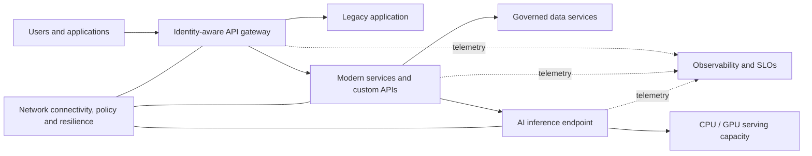

# Reference architecture (conceptual)

The gateway may direct selected functionality to new services while legacy components remain operational. This is a conceptual illustration, not a deployment configuration.

## Design review prompts

1. **Migration:** Which services can be rehosted, replatformed, replaced, retained or retired? What are their dependencies?
2. **Modernization:** Can traffic be shifted incrementally with contract tests and a safe rollback?
3. **Custom integration:** Are API ownership, authorization, data contracts and error handling explicit?
4. **AI serving:** Have representative models and traffic been benchmarked for cost, latency and throughput?
5. **Networking:** What are the network failure modes, latency budgets and failover tests?

## Safety notes

Never expose an inference endpoint without appropriate authentication, authorization and rate limits. Do not publish live architecture diagrams containing internal hostnames, credentials, network routes or sensitive asset inventories.
